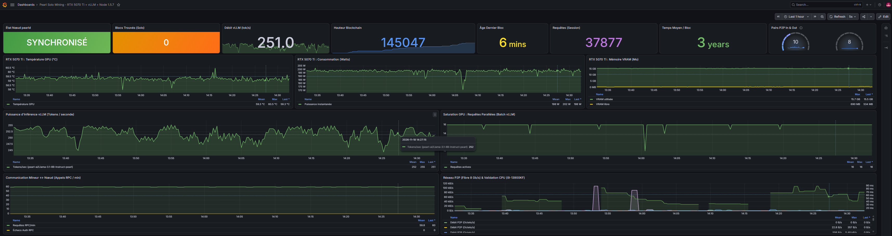

# Pearl Solo Mining Suite — RTX 50xx (Blackwell `sm120`) + WSL2 + Grafana

Suite complète de minage solo pour le réseau **Pearl (PRL)** sur GPU **NVIDIA RTX 50xx (`sm120`)** sous **WSL2**, intégrant le nœud local, la supervision (Prometheus/Grafana) et les alertes.



## Prérequis indispensables
1. **Réseau WSL2 :** Copiez `wslconfig.example` vers `C:\Users\<VotreNom>\.wslconfig` sous Windows et exécutez `wsl --shutdown` dans PowerShell pour appliquer `networkingMode=mirrored`.
2. **Nœud `pearld` :** Exécutez le nœud v1.5.7+ sur stockage `ext4` avec `pearld.conf` configuré (identifiants RPC et IP externe), puis attendez la synchronisation complète (`pearld_chain_is_current = 1`).
3. **Port P2P `44108` & Pare-feu :** Ouvrez le port 44108 (TCP) en redirection NAT et exécutez dans PowerShell (Administrateur) :
   ```powershell
   New-NetFirewallRule -DisplayName "Pearl Node P2P" -Direction Inbound -LocalPort 44108 -Protocol TCP -Profile Any -Action Allow
   Set-NetFirewallHyperVVMSetting -Name '{40E0AC32-46A5-438A-A0B2-2B479E8F2E90}' -DefaultInboundAction Allow
   ```
   *(Gardez le port RPC `44107` fermé vers l'extérieur).*
git clone http://github.com/fishhot75012/pearl-rtx50xx-solo-suite.git

## Fonctionnalités & Démarrage rapide
- **Support NVIDIA Blackwell (`sm120`) :** Adaptation du mineur vLLM (`v1.5.7-sm120`) et optimisation mémoire (`--gpu-memory-utilization 0.80`) pour GPU 16 Go (RTX 5070 Ti).
	Automatisation du mineur (`start_pearl_miner.sh`), métriques Prometheus/Grafana (exportateurs GPU `9400` et Solo `9401`), et alertes SMTP.
- **Démarrage automatisé (`start_pearl_miner.sh`) :** Lancement du conteneur Docker, attente du chargement du modèle en VRAM et boucle parallèle de génération.
- **Supervision complète (Prometheus + Grafana) :**
  - Métriques natives `pearld` 1.5.7 (`localhost:9105`) : hauteur de bloc, synchro, pairs P2P (`inbound`/`outbound`), appels RPC.
  - Métriques vLLM (`localhost:8000`) : débit en `tokens/s`, saturation du batch GPU.
  - Exportateur GPU léger basé sur `nvidia-smi` (`gpu_exporter.py` sur port `9400`) : contournement fiable de DCGM sous WSL2 (Température, Watts, VRAM).
  - Exportateur Solo & Probabilités (`solo_exporter.py` sur port `9401`) : comptage des blocs solo trouvés, requêtes de session et calcul dynamique du Temps Moyen Estimé (TTF).
- **Lancement :** 
  - Configurez votre fichier `.env` via `cp .env.example .env`
  - Démarrez la supervision avec:
  `cd monitoring && docker compose --env-file ../.env up -d` 
  - importez le tableau de bord Grafana, puis lancez:
  `./start_pearl_miner.sh`.
- **Alertes Email (SMTP Grafana) :** Notification instantanée dès qu'un bloc solo est validé (`increase(pearl_solo_blocks_found[5m]) > 0`).

## Crédits & Licence
- **Auteur :** [@fishhot75012](https://github.com) assisté par Google.
- **Licence :** Distribué sous licence **ISC** (voir [LICENSE](LICENSE)).
